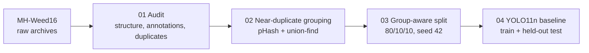

# Weed Detection on MH-Weed16: Dataset Audit, Leakage-Aware Split and YOLO11n Baseline

Object detection of 15 weed species in field images. The work so far covers a full audit of the MH-Weed16 detection data, a train/val/test split that prevents near-duplicate images from leaking across partitions, and a reproducible YOLO11n baseline.

> **Status:** baseline complete.

## Headline results

Held-out test set (662 images, 6,154 boxes), YOLO11n pretrained, trained for 100 epochs:

| Precision | Recall | mAP@50 | mAP@50-95 |
|---|---|---|---|
| 0.671 | 0.611 | 0.639 | **0.316** |

Validation (668 images) with the same checkpoint: P 0.665, R 0.612, mAP@50 0.635, mAP@50-95 0.311.

## Pipeline

| # | Notebook | What it does | Open |
|---|---|---|---|
| 01 | `01_environment_and_dataset_investigation.ipynb` | Inspects the raw archives, verifies image/annotation pairing, compares the JSON, YOLO-txt and Pascal VOC annotations, and audits class balance |  |
| 02 | `02_dataset_preparation.ipynb` | Finds near-duplicate images with perceptual hashing and assigns every image to a near-duplicate group |  |
| 03 | `03_dataset_split_and_experiment_setup.ipynb` | Builds a class-stratified train/val/test split over groups and audits it for leakage and class coverage |  |
| 04 | `04_baseline_object_detection.ipynb` | Converts labels to YOLO format, trains the YOLO11n baseline, evaluates on the held-out test set, and saves the experiment record |  |

## Dataset

MH-Weed16 is a weed dataset with 16 species. This project uses the **detection subset**: the Intel RealSense field images, which are the images with bounding-box annotations.

| Property | Value |
|---|---|
| Images | 6,656 (all RGB, 1920 × 1080, all readable) |
| Bounding boxes | 62,052 (avg. 9.3 per image, max 35; 8 images have none) |
| Detection classes | 15 (the 16th species, Punarnava, has no detection annotations) |
| Annotation format used | JSON (normalized YOLO-style boxes) |

The archive also holds Canon, iPhone and UAV images and 19,141 single-species PNGs. They have no detection annotations and are not used here.

### Findings from the audit

- **JSON and YOLO-txt annotations are identical** for all 6,656 images. The **Pascal VOC XML files disagree with them** for some images: 360 have a different number of objects, and one class ID maps to two species names. JSON is therefore treated as the ground truth.
- **No exact duplicates**, but **326 near-duplicate image pairs** (perceptual hash, Hamming distance ≤ 8) form **134 groups containing 351 images**. Visual inspection shows these are different frames of the same scene.
- **Strong class imbalance.** Two classes (*Cyperus rotundus* and *Chenopodium*) hold about 73% of all boxes. The rarest class has only 55 images.
- **12 malformed boxes** (zero width or height) were found and excluded, leaving **62,040 valid boxes**.

## Leakage-aware split

Random image-level splits would put near-identical frames in both train and test, which inflates test scores. Instead, the **near-duplicate group is the splitting unit**: groups are assigned greedily, rarest classes first, to keep class proportions similar across partitions. Seed 42.

| Split | Images | Groups | Boxes |
|---|---|---|---|
| Train | 5,326 | 5,151 | 49,448 |
| Val | 668 | 644 | 6,438 |
| Test | 662 | 644 | 6,154 |

The audit found **zero groups crossing splits**, and **all 15 classes appear in every split** with matching class proportions.

## Baseline model

| Setting | Value |
|---|---|
| Model | YOLO11n, pretrained (Ultralytics), ~2.6 M parameters |
| Training | 100 epochs, image size 640, batch 16, seed 42, deterministic |
| Hardware | Google Colab Tesla T4, about 4.1 h |
| Software | Python 3.13, PyTorch 2.11 (CUDA 12.8), Ultralytics 8.4.144 |
| Inference speed | about 4.6 ms per image on the T4 (evaluation setting) |

Hyperparameters were not tuned in these notebooks. Experiment ID: `baseline_yolo_20260909_095854`.

### Per-class test results

| ID | Species | Scientific name | Images | Boxes | mAP@50 | mAP@50-95 |
|---|---|---|---|---|---|---|
| 0 | Kena | *Commelina benghalensis* | 3,377 | 6,512 | 0.762 | 0.406 |
| 1 | Lavhala | *Cyperus rotundus* | 5,059 | 22,739 | 0.565 | 0.233 |
| 2 | Lamb's quarters | *Chenopodium* sp. | 5,546 | 22,394 | 0.722 | 0.296 |
| 3 | Little mallow | *Malva parviflora* | 1,356 | 2,217 | 0.878 | 0.599 |
| 4 | Moti dudhi | *Euphorbia geniculata* | 1,021 | 1,804 | 0.757 | 0.378 |
| 5 | Obscure morning glory | *Ipomoea obscura* | 1,091 | 2,278 | 0.547 | 0.289 |
| 6 | Asian pigeonwings | *Clitoria ternatea* | 173 | 181 | 0.701 | 0.353 |
| 7 | Bilayat | *Argemone mexicana* | 186 | 214 | 0.792 | 0.329 |
| 8 | Choti dudhi | *Euphorbia hirta* | 615 | 836 | 0.592 | 0.272 |
| 9 | Digitaria | *Digitaria sanguinalis* | 721 | 1,425 | 0.517 | 0.197 |
| 10 | Gajar gavat | *Parthenium hysterophorus* | 343 | 476 | 0.779 | 0.430 |
| 11 | Graceful sandmat | *Euphorbia hypericifolia* | 88 | 126 | 0.317 | 0.165 |
| 12 | Sicklepod | *Senna obtusifolia* | 333 | 399 | 0.502 | 0.259 |
| 13 | Harali | *Cynodon dactylon* | 55 | 184 | 0.309 | 0.082 |
| 14 | Dwarf cassia | *Chamaecrista pumila* | 228 | 267 | 0.847 | 0.443 |

Names follow the dataset's folder names. Image and box counts are for the full dataset before the 12 invalid boxes were removed.

**Observations**
- The most frequent classes are not the best-detected. Classes 1 and 2 hold about 73% of boxes yet score 0.233 and 0.296 mAP@50-95. Little mallow (class 3) scores highest at 0.599.
- The weakest results are on the rarest classes (*Cynodon dactylon* 0.082, *Euphorbia hypericifolia* 0.165).
- Test counts for rare classes are tiny (class 11 has 12 test boxes, class 13 has 23), so their per-class scores are noisy.

## Limitations

- All images come from one sensor (Intel RealSense, 1920 × 1080), so generalization to other cameras or fields is untested.
- Near-duplicate detection uses a perceptual-hash threshold. Filename components were not reliable session identifiers, so some residual leakage between related scenes can't be ruled out.

## Roadmap

- Address class imbalance (class weighting, resampling, augmentation)
- Compare larger YOLO11 variants and other detectors
- Error analysis on the weakest classes
- Multi-seed runs for confidence intervals

## Reproducing

1. Download MH-Weed16 and place the zip files at `MyDrive/dissertation_weed_detection/01_data/raw/MH-Weed16/`. The data is not included in this repository.
2. Open the notebooks in Colab and run them in order. Set `PROJECT_ROOT` in the first cell if you use a different path.
3. Notebook 04 needs a GPU runtime.

## Acknowledgements and licenses

- Dataset: https://data.mendeley.com/datasets/d3n3mgjjbv/2. Check the dataset license before redistributing any data.
- Model and training: [Ultralytics](https://github.com/ultralytics/ultralytics) YOLO11, which is AGPL-3.0 licensed.
